<picture>
  <source media="(prefers-color-scheme: dark)" srcset="./assets/banner-motion-dark.svg">
  
</picture>

  <strong>中文</strong> &nbsp; / &nbsp; <a href="./README.en.md">English</a>

    
  <strong>通信工程在读 · 嵌入式 · Linux · 端侧 AI</strong> 
  从 EE 走向 CS：从底层硬件做起，往计算机系统的上层走

## 👋 你好，我是 Caden

我从通信工程出发，正在一步步走向计算机系统。最早和单片机、外设打交道，后来在 Linux 上做多进程和端侧推理；兴趣也从“让一个功能跑起来”，慢慢落到它背后的调度、通信和资源管理上。

我喜欢顺着问题往下看一层：数据在哪里等待？取消之后，旧结果为什么还会回来？一个进程退出，会牵动系统的哪一部分？嵌入式的经历让我对时序、内存和硬件约束比较敏感，而这些问题的答案，大多在软件那一侧。

🎯 **现在的主线是计算机系统。** 我想带着这份硬件直觉，把这些问题放回系统里看；一边补基础，一边把理解放进项目里验证。

## 🧰 手边的工具

<!-- Theme-aware SVG assets are stored in this repository. -->

<picture><source media="(prefers-color-scheme: dark)" srcset="./assets/chips/label-0-night.svg"></picture> <picture><source media="(prefers-color-scheme: dark)" srcset="./assets/chips/c-night.svg"></picture> <picture><source media="(prefers-color-scheme: dark)" srcset="./assets/chips/cplusplus-night.svg"></picture> <picture><source media="(prefers-color-scheme: dark)" srcset="./assets/chips/python-night.svg"></picture> <picture><source media="(prefers-color-scheme: dark)" srcset="./assets/chips/gnubash-night.svg"></picture> <picture><source media="(prefers-color-scheme: dark)" srcset="./assets/chips/linux-night.svg"></picture>
 
<picture><source media="(prefers-color-scheme: dark)" srcset="./assets/chips/label-1-night.svg"></picture> <picture><source media="(prefers-color-scheme: dark)" srcset="./assets/chips/stmicroelectronics-night.svg"></picture> <picture><source media="(prefers-color-scheme: dark)" srcset="./assets/chips/arm-night.svg"></picture> <picture><source media="(prefers-color-scheme: dark)" srcset="./assets/chips/rtos-night.svg"></picture> <picture><source media="(prefers-color-scheme: dark)" srcset="./assets/chips/bus-night.svg"></picture>
 
<picture><source media="(prefers-color-scheme: dark)" srcset="./assets/chips/label-2-night.svg"></picture> <picture><source media="(prefers-color-scheme: dark)" srcset="./assets/chips/cmake-night.svg"></picture> <picture><source media="(prefers-color-scheme: dark)" srcset="./assets/chips/zeromq-night.svg"></picture>
 
<picture><source media="(prefers-color-scheme: dark)" srcset="./assets/chips/label-3-night.svg"></picture> <picture><source media="(prefers-color-scheme: dark)" srcset="./assets/chips/git-night.svg"></picture> <picture><source media="(prefers-color-scheme: dark)" srcset="./assets/chips/docker-night.svg"></picture> <picture><source media="(prefers-color-scheme: dark)" srcset="./assets/chips/githubactions-night.svg"></picture> <picture><source media="(prefers-color-scheme: dark)" srcset="./assets/chips/claude-night.svg"></picture> <picture><source media="(prefers-color-scheme: dark)" srcset="./assets/chips/modelcontextprotocol-night.svg"></picture>

 
其他探索： <picture><source media="(prefers-color-scheme: dark)" srcset="./assets/chips/opencv-night.svg"></picture> <picture><source media="(prefers-color-scheme: dark)" srcset="./assets/chips/ros-night.svg"></picture>

 

<!-- ============ Sky ============ -->

  <picture>
    <source media="(prefers-color-scheme: dark)" srcset="./assets/sky-night.svg" />
    
  </picture>

## 📊 公开的记录

<!-- Public owned, non-fork repositories; refreshed by profile-assets.yml. -->

  <picture>
    <source media="(prefers-color-scheme: dark)" srcset="https://raw.githubusercontent.com/Caden-1224/Caden-1224/output/stats-dark.svg" />
    
  </picture>

仅统计本人名下的公开非 fork 仓库；commit 数为各仓库当前默认分支历史中本人提交的累计数量。 计划每 10 分钟刷新，实际更新时间见卡片。 <a href="https://github.com/Caden-1224/Caden-1224/actions/workflows/profile-assets.yml">查看同步状态</a>

<!-- Contribution animation is published independently from the stats card. -->

  <picture>
    <source media="(prefers-color-scheme: dark)" srcset="https://raw.githubusercontent.com/Caden-1224/Caden-1224/output/github-contribution-grid-snake-dark.svg" />
    
  </picture>

---

💬 如果你也在学系统、折腾嵌入式，或者同样在从 EE 往 CS 走，欢迎来聊聊。

[Email](mailto:seekercaden@outlook.com) &nbsp; · &nbsp; [GitHub](https://github.com/Caden-1224)
